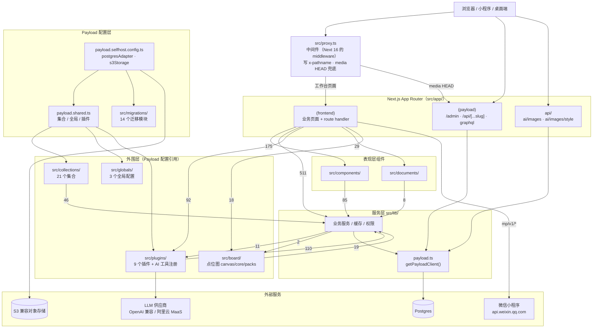
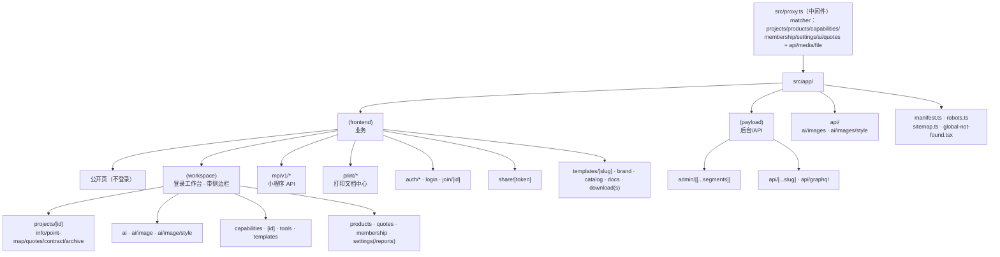
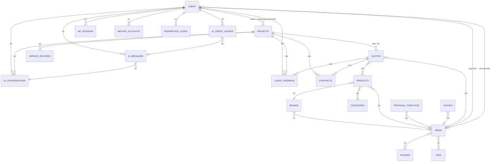
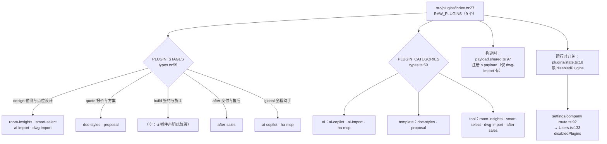
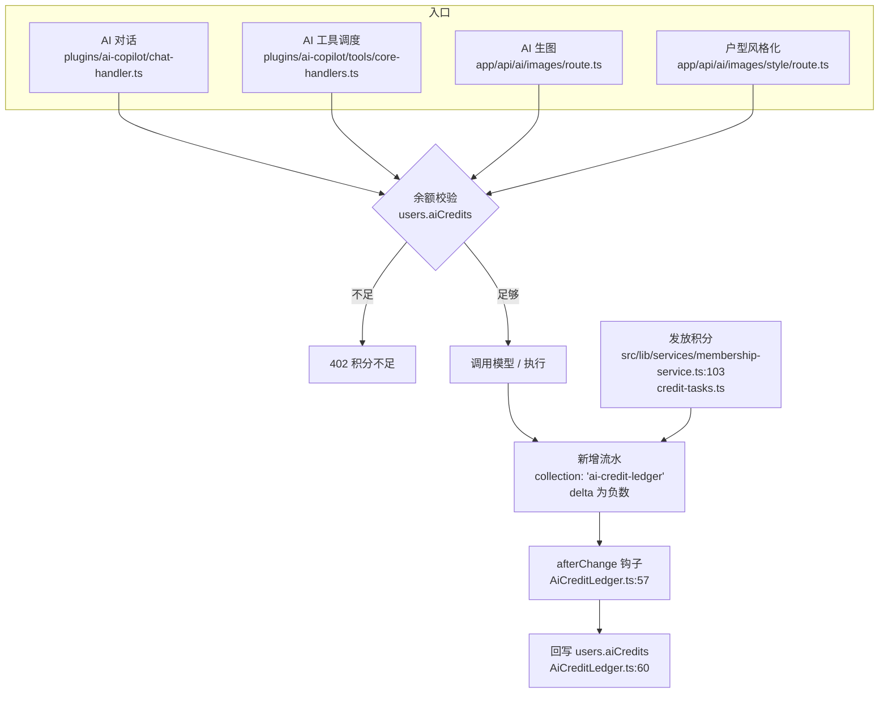

# 繁梦空间 · 整体技术架构图

> 从仓库真实结构提取（不是示意），每个事实都标了 `文件:行号` 或可直接复跑的 grep。
> 主要来源：`src/app/` 目录树、`src/lib/payload.ts`、`src/payload.shared.ts`、
> `src/payload.selfhost.config.ts`、`src/plugins/index.ts`、`src/plugins/types.ts`、
> `src/collections/`。更新方式见附录 B。
> 基线：`origin/main` @ `36c6040`。

## 一、一句话全貌

浏览器 → **Next.js 中间件**（`src/proxy.ts`，Next 16 里 `middleware.ts` 的改名）→
**Next.js App Router**（route group：`(frontend)` 业务、`(payload)` 后台，外加顶层 `api/`）→
**页面 / route handler** → **`src/lib/` 服务层** → **Payload Local API**（`getPayloadClient()`）
→ **Postgres**（`postgresAdapter`，`src/payload.selfhost.config.ts:158`）。

插件、点位图引擎、数据集合、全局配置、数据库迁移、文档模板都是挂在上述主链上的外围层：
插件挂页面/入口与 AI 工具，`src/board/` 是点位图渲染引擎，`src/collections/` 与
`src/globals/` 只在 Payload 配置层被引用，`src/migrations/` 描述数据库结构的演进。
除 Postgres 外还有三个外部服务：S3 兼容对象存储、LLM 供应商、微信小程序接口。



边上的数字是实测 import 语句数（`grep -rn "from '@/<层>" src/<来源层> | wc -l`，见附录 B 命令）。

## 二、目录分层与依赖规则

| 层           | 位置               | 职责                                           | 允许依赖                             | 实测依赖边                                                                |
| ------------ | ------------------ | ---------------------------------------------- | ------------------------------------ | ------------------------------------------------------------------------- |
| 路由/页面    | `src/app/`         | 页面、route handler、Server Action             | 组件、服务层、插件、documents、board | → lib 511 · → components 175 · → plugins 92 · → documents 29 · → board 18 |
| 中间件       | `src/proxy.ts`     | 写 `x-pathname`、media HEAD 兜底               | 无（只 import `next/server`）        | 无跨层 import                                                             |
| 组件         | `src/components/`  | 可复用 UI（含 Astryx 封装）                    | lib、documents、board                | → lib 85 · → plugins 7 · → documents 6 · → board 2                        |
| 服务层       | `src/lib/`         | 业务逻辑、缓存、权限、Payload 客户端           | 插件、board、documents（存在反向边） | → plugins 11 · → board 2 · → components 2 · → documents 1                 |
| 文档模板     | `src/documents/`   | 打印/文档的版式注册表                          | lib、plugins                         | → lib 8 · → plugins 2                                                     |
| 插件         | `src/plugins/`     | 外围能力：AI 对话/识图、DWG、方案、售后等      | lib、components、documents           | → lib 110 · → components 13 · → documents 7                               |
| 点位图引擎   | `src/board/`       | 户型图 canvas、几何、符号包、历史栈            | lib、components                      | → lib 19 · → components 1                                                 |
| 数据模型     | `src/collections/` | Payload 集合定义（字段、access、hooks）        | lib、plugins/proposal/framework      | → lib 46 · → plugins 1                                                    |
| 全局配置     | `src/globals/`     | Payload globals：公司抬头、AI 设置、会员设置   | lib、plugins                         | → lib 7 · → plugins 3                                                     |
| 数据库迁移   | `src/migrations/`  | 结构演进脚本（自托管配置专用）                 | 无（纯 DDL/SQL）                     | 无跨层 import                                                             |
| Payload 配置 | `src/payload*.ts`  | 组装 collections/globals/plugins、数据库与存储 | 全部（唯一的集合引用点）             | `payload.shared.ts` import collections 21 处                              |

**硬规则（已 grep 实测）**：没有任何页面或 route handler 直接 import `src/collections/`。

```bash
grep -rn "from '@/collections" src/app | wc -l   # → 0
grep -rn "from '@/collections" src/lib | wc -l   # → 0
grep -rn "from './collections" src             # → 只有 src/payload.shared.ts 21 行
```

所有数据访问都走 `src/lib/payload.ts`：`getPayloadClient()`（`src/lib/payload.ts:11`）
在 `src/` 下被引用 208 处，其中 `src/app/` 84 处。集合一律用字符串 slug 访问（`payload.find({ collection: 'users' })`），
不 import 集合对象。

**实测的依赖环（package 级，非文件级）**：

- `lib ↔ plugins`：lib → plugins 11、plugins → lib 110 → **成环**。
- `lib ↔ board`：lib → board 2、board → lib 19 → **成环**。
- `lib ↔ documents`：lib → documents 1、documents → lib 8 → **成环**。
- `lib → components` 2 处全是 `import type`（`src/lib/social-poster.ts:1`、`src/lib/quote-areas.ts:7`），
  运行时不成环，但是类型层反向依赖。
- **层级倒挂**：数据模型层反过来 import 插件层 —— `src/collections/ProposalTemplates.ts:9`
  从 `@/plugins/proposal/framework` 取 `DECK_SECTIONS / ORCHESTRATION_RULES / PROPOSAL_FRAMEWORKS`。
  collections → plugins 1 处，属真实的层间倒挂。

### 中间件 / 全局配置 / 数据库迁移

这三层此前没进图，分别说明：

- **中间件 `src/proxy.ts`**：Next 16 把 `middleware.ts` 改名为 `proxy.ts`，导出的函数也叫
  `proxy`（`src/proxy.ts:32`），`config.matcher`（`src/proxy.ts:46`）列了 8 条路径
  （7 个工作台页面前缀 + `/api/media/file/:path*`）。两个职责：给工作台页面写请求头
  `x-pathname`（唯一消费者是 `src/lib/login-redirect.ts:11`，拼 `/login?from=`）；把
  `/api/media/file/` 的 HEAD 请求转成内部 GET 再回传状态码/响应头（Payload 只注册了 GET，
  否则 HEAD 一律 404，且被 `next.config.ts` 的强缓存固化）。**它不做鉴权**——
  每个页面/接口/Server Action 各自校验登录与权限。
- **全局配置 `src/globals/`**：3 个 Payload global，`src/payload.shared.ts:85` 注册 ——
  `CompanySettings`（slug `company-settings`，抬头与默认条款）、`AiSettings`（slug `ai-settings`，
  AI 模型/渠道，另挂 `ai-settings-endpoints`）、`MembershipSettings`（slug `membership-settings`，
  会员分级已移除，只剩积分充值引导文案）。
- **数据库迁移 `src/migrations/`**：`src/migrations/index.ts` 导出 `migrations` 数组，含 14 个
  迁移模块（另有等名 `.json` 快照）。它**只在自托管配置里生效**：`migrationDir`（`selfhost:167`）、
  `prodMigrations`（`selfhost:171`）在 `NODE_ENV === 'production'` 下自动执行；开发态走 `push`
  （`selfhost:172`），所以结构变更必须落迁移文件，`push` 只给本地 `pnpm dev`。

**外部服务不止 Postgres**：

- **Postgres**：`postgresAdapter`（`src/payload.selfhost.config.ts:158`），UUID 主键、允许带 ID 导入。
- **S3 兼容对象存储**：`s3Storage`（`src/payload.selfhost.config.ts:3` 引入、`174-190` 使用），
  由 `S3_BUCKET` 是否设置决定（`selfhost:21`）；未配置 S3 时回退本地 `MEDIA_DIR`，并挂一个自实现的
  `/file/:filename` 端点（`selfhost:40-147`，带 sharp WebP 缩略图与 ETag）。
- **LLM 供应商**：聊天走 OpenAI 兼容渠道，每个渠道自带 `baseUrl` / `apiKeyEnv`（`AiSettings`），
  另支持 `NEWAPI_API_KEY` / `ONEAPI_KEY`；AI 生图走阿里云百炼 MaaS 端点
  （`src/plugins/ai-copilot/image-generation.ts:9`）。
- **微信小程序**：`src/app/(frontend)/mp/v1/*` 的 33 个 route 由小程序调用，登录换 openid 打的是
  `https://api.weixin.qq.com/sns/jscode2session`（`src/lib/mp/auth.ts:191`）。

## 三、真实路由全貌

从 `src/app/` 目录树直接提取。`(frontend)` 下 46 个 `page.tsx`、58 个 `route.ts`。



要点（从目录实测）：

- **中间件 `src/proxy.ts`** 挂在所有路由最前面（Next 16 起 `middleware.ts` 改名 `proxy.ts`，
  导出函数也叫 `proxy`）：它只做两件事——给工作台页面写请求头 `x-pathname`（供
  `src/lib/login-redirect.ts:11` 拼 `/login?from=` 回跳）、把 `/api/media/file/` 的 HEAD 请求
  转成内部 GET 兜底 404（`src/proxy.ts:32-44`）。它**不做鉴权**，权限仍由各页面/接口自校验。
- 顶层 `src/app/api/` 只有两个 AI 生图 route（`ai/images`、`ai/images/style`），既不在
  `(frontend)` 也不在 `(payload)`；它与 `(payload)/api/[...slug]` 的 catch-all 同属 `/api`
  命名空间，命中时按更具体的静态路由优先。
- `(frontend)/(workspace)` 是嵌套 route group：它的 `layout.tsx` 读公司设置与插件开关后再渲染侧边栏
  （`src/app/(frontend)/(workspace)/layout.tsx:35`）。
- 项目主链路页面都在 `projects/[id]/`：`page.tsx`（信息）、`point-map`、`quotes`、`contract`、
  `archive`、`after-sales`；`point-map` 下还有 `sheets` `dwg` `data` `defaults` `auto-defaults` 等
  route handler。
- 未落到工作台的旧入口 `login/`、`download/`、`downloads/` 都在 `(frontend)` 下 `join`、`mp/web-login`。
- Payload 后台与 REST/GraphQL 全部在 `(payload)`：`admin/[[...segments]]`、`api/[...slug]`。
- route.ts 计数：全仓 64 个 —— `(frontend)` 58、`(payload)` 4、顶层 `api/` 2。

## 四、数据模型

`src/collections/` 共 21 个集合，全部在 `src/payload.shared.ts:62` 注册。关系以
`relationTo` 实测提取。



标注数字为关系字段所在行号（`文件` 见下表）。**`o|` 表示「零或一」**：这些 upload/relationship 字段块里都没有
`required: true`，留空是允许的；只有 `PRODUCTS }o--|| BRANDS(79)` 是必填（`src/collections/Products.ts:80`
确有 `required: true`）。`USERS` 的 `logo`(108) 与 `qrCode`(109) 是**两个各自可选**的 upload 字段，
所以拆成两条而不是一条「每个 user 恰好一个 media」。
全仓 31 处 `relationTo`，上图逐条对应；`Quotes.ts:142`（报价行项 `image` → `media`）是原先漏掉的那条。

归属分组：**核心链路**（users/projects/quotes/contracts/service-records/client-feedback/products/brands/categories/media/folders/tags）、
**账号**（users/admins/wechat-accounts/mp-sessions/redemption-codes）、**AI**（ai-conversations/ai-messages/ai-credit-ledger）、
**内容与模板**（scenes/proposal-templates）。

| 集合（slug）          | 定义文件                                  | 关键关系                                                           |
| --------------------- | ----------------------------------------- | ------------------------------------------------------------------ |
| `users`               | `src/collections/Users.ts:21`             | 项目 owner/协作者、各 AI 集合、媒体 logo/qrCode                    |
| `projects`            | `src/collections/Projects.ts:74`          | owner→users(195)、quotes(260)、collaborators→users(305)            |
| `quotes`              | `src/collections/Quotes.ts:44`            | projects(114)、products(135)、media(142，行项图片)                 |
| `contracts`           | `src/collections/Contracts.ts:65`         | projects(204)、quotes(213)                                         |
| `service-records`     | `src/collections/ServiceRecords.ts:30`    | projects(113)                                                      |
| `client-feedback`     | `src/collections/ClientFeedback.ts:53`    | projects(209)、quotes(218)、users(307)                             |
| `products`            | `src/collections/Products.ts:19`          | brands(79)、categories(86)、media(98)                              |
| `brands`              | `src/collections/Brands.ts:8`             | media(24)                                                          |
| `categories` / `tags` | `Categories.ts:8` / `Tags.ts:4`           | — / media(40)                                                      |
| `media` / `folders`   | `Media.ts:10` / `Folders.ts:4`            | folders(39)、tags(40)                                              |
| `scenes`              | `src/collections/Scenes.ts:16`            | media(125)                                                         |
| `proposal-templates`  | `src/collections/ProposalTemplates.ts:30` | media(201)、**反向 import 插件 framework(9)**                      |
| `ai-conversations`    | `src/collections/AiConversations.ts:14`   | users(44)、projects(53)                                            |
| `ai-messages`         | `src/collections/AiMessages.ts:13`        | ai-conversations(32)、users(40)                                    |
| `ai-credit-ledger`    | `src/collections/AiCreditLedger.ts:18`    | users(78)、ai-messages(96)                                         |
| `admins`              | `src/collections/Admins.ts:6`             | 后台 CMS 账号（`sharedConfig.admin.user`，`payload.shared.ts:42`） |

## 五、插件体系

注册表在 `src/plugins/index.ts:27` 的 `RAW_PLUGINS`，共 **9 个插件**；阶段定义在
`src/plugins/types.ts:55` 的 `PLUGIN_STAGES`，分 5 段；分类定义在 `src/plugins/types.ts:69`
的 `PLUGIN_CATEGORIES`（AI 能力 / 模板 / 工具）。插件的 Payload 层扩展在构建时由
`src/payload.shared.ts:97`（`...PLUGINS.flatMap((p) => (p.payload ? [p.payload] : []))`）注册。

> 注意区分两个「Payload 插件」概念：`payload.shared.ts:95` 还单独注册了官方
> `mcpPlugin({})`（`@payloadcms/plugin-mcp`），它**不在**这 9 个应用插件里，也不走
> `RAW_PLUGINS`。别把它与 `ha-mcp`（第 131 行注册的应用插件，经 MCP 协议连客户现场的
> Home Assistant）混为一谈。



| 阶段 key | 名称           | 主链路      | 插件（实测 `stage`）                                                       |
| -------- | -------------- | ----------- | -------------------------------------------------------------------------- |
| `design` | 勘测与点位设计 | 信息 · 点位 | `room-insights` · `smart-select` · `ai-import` · `dwg-import`              |
| `quote`  | 报价与方案     | 报价        | `doc-styles` · `proposal`                                                  |
| `build`  | 签约与施工     | 合同        | **空**（无插件 `stage: 'build'`，`grep "stage: 'build'" src/plugins` → 0） |
| `after`  | 交付与售后     | 归档        | `after-sales`                                                              |
| `global` | 全程助手       | 全程        | `ai-copilot` · `ha-mcp`                                                    |

**何时被加载**：

- 构建时：只有声明了 `payload:` 的插件会注册 Payload 扩展。9 个插件里只有 `dwg-import`
  （`src/plugins/index.ts:112`）带 `payload`，其余 8 个是纯前端/服务端能力。
- 运行时：`src/plugins/state.ts:18` 的 `getPluginFlags()` 读公司设置的 `disabledPlugins`，
  生成 `Record<PluginId, boolean>`；`src/app/(frontend)/(workspace)/layout.tsx:35` 用它决定侧边栏暴露哪些插件入口。

**开关的现状（重要，与文档不符，见附录 A）**：数据层与接口层都支持用户开关
（`Users.ts:133` 的 `disabledPlugins` JSON 字段、`settings/company/route.ts:92-95` 从表单
`plugins-present` / `plugin-<id>` 收集关闭项），但**界面上没有任何开关** ——
`grep -rn "plugins-present" src` 只有 route 一处命中，没有任何 `tsx` 生成该表单字段；
`capabilities/plugin-list.tsx:33` 注释也写明「普通用户不安装、不启停，因此这里没有任何开关」。

## 六、AI 模块与积分链路

AI 能力仍是插件形态：`ai-copilot`（AI 对话，global）、`ai-import`（识别导入，design）、
`ha-mcp`（现场设备对接，global）三个插件的 `category: 'ai'`（`src/plugins/index.ts:30,91,132`）。



计费点实测（新增一条 `ai-credit-ledger` 流水）。本列「余额校验」指**判断余额是否够用的那一行**
（`if (... aiCredits ...) < 成本`），不是上面读余额的 `select: { aiCredits: true }`：

| 入口              | 余额校验（判断行）                | 扣费写流水                        |
| ----------------- | --------------------------------- | --------------------------------- |
| AI 对话           | `chat-handler.ts:211`             | `chat-handler.ts:665`             |
| AI 工具（跨插件） | `core-handlers.ts:1232`           | `core-handlers.ts:1278`           |
| AI 生图           | `api/ai/images/route.ts:68`       | `api/ai/images/route.ts:80`       |
| 户型图风格化      | `api/ai/images/style/route.ts:62` | `api/ai/images/style/route.ts:79` |

**余额的唯一真源是 `users.aiCredits`**，只能通过新增流水改变：`AiCreditLedger.ts:34` 的
`beforeChange` 计算 `balanceAfter = user.aiCredits + delta` 并对负数余额抛 402；
`AiCreditLedger.ts:57` 的 `afterChange` 把 `balanceAfter` 写回 `users.aiCredits`。
集合 access 限制为 `create: isCmsAdmin`、`update/delete: false`（`AiCreditLedger.ts:27-32`）。

## 附录 A：文档与代码不一致清单

给 owner 拍板用，不是要改文档。每条：文档怎么写 → 代码实际是什么 → 影响。

| #   | 文档怎么写（file:line）                                                                                                                                                                      | 代码实际是什么（file:line / grep）                                                                                                                                       | 影响                                                                                                                                                                                                                              |
| --- | -------------------------------------------------------------------------------------------------------------------------------------------------------------------------------------------- | ------------------------------------------------------------------------------------------------------------------------------------------------------------------------ | --------------------------------------------------------------------------------------------------------------------------------------------------------------------------------------------------------------------------------- |
| 1   | `PROJECT-ARCHITECTURE.md:286-298` 列插件清单为 11 项（方案演示、文档风格包、DWG 导入、房间智能分析、智能选型、现场勘测表、强弱电布线表、采购与备货单、场景与账号移交、售后维保记录、仪表盘） | `src/plugins/index.ts:27-143` 实际 9 个：ai-copilot、doc-styles、proposal、room-insights、smart-select、ai-import、dwg-import、after-sales、ha-mcp                       | 文档里的「现场勘测表 / 强弱电布线表 / 采购与备货单 / 场景与账号移交 / 仪表盘」都不是插件（`grep "'survey'\|'wiring'\|'procurement'\|'dashboard'" src/plugins` → 0）；文档漏掉 ai-copilot、ai-import、ha-mcp。按文档找插件会找不到 |
| 2   | `PROJECT-ARCHITECTURE.md:300-308` 说 AI 对话、AI 识别导入、户型图风格化、AI 生图、AI 智能布点「从插件移到 AI 模块」                                                                          | 代码里 AI 对话 = 插件 `ai-copilot`、AI 识别导入 = 插件 `ai-import`，`category: 'ai'`（`index.ts:30,91`）                                                                 | AI 能力仍是插件形态，不是独立于插件体系的模块；文档的「三类并行」表述与实现不符                                                                                                                                                   |
| 3   | `PROJECT-ARCHITECTURE.md:506-516` §4.6.2「没有用户启停 / 不做开启关闭插件」                                                                                                                  | 数据层与接口层都有开关：`Users.ts:133` `disabledPlugins`、`settings/company/route.ts:92-95`、`plugins/state.ts:18`；但**没有 UI 生成 `plugins-present` / `plugin-<id>`** | 半成品：后端开关是死代码，用户界面确实不能开关。要么补 UI，要么删掉 route/字段                                                                                                                                                    |
| 4   | `PROJECT-ARCHITECTURE.md:619-626` §6 工具中心写作 `/plugins/tools`                                                                                                                           | 真实路由是 `src/app/(frontend)/(workspace)/capabilities/tools/page.tsx` → `/capabilities/tools`                                                                          | 文档 URL 过时；`next.config.ts:29-30` 用 `permanent: true` 配了 `/plugins → /capabilities` 的 **308**（Next.js 对 `permanent: true` 发 308，不是 301），老链接仍可用，但要两次跳转                                                |
| 5   | `PROJECT-ARCHITECTURE.md:664-671` §7.2 模板中心写作 `/plugins/templates`                                                                                                                     | 真实路由 `capabilities/templates/page.tsx` → `/capabilities/templates`                                                                                                   | 同上                                                                                                                                                                                                                              |
| 6   | `PROJECT-ARCHITECTURE.md:136` 「会员等级字段仍在：`membershipTier` / `membershipExpiresAt`」                                                                                                 | `grep -rn 'membershipTier' src` → 0；`membershipExpiresAt` → 0（`src/lib/membership-policy.ts` 仍在但已无字段）                                                          | 文档滞留；会员分级已在代码里彻底移除，只剩积分                                                                                                                                                                                    |
| 7   | `PROJECT-ARCHITECTURE.md:322` 「`ProjectToolbox` 组件存在…死代码」、`:363` 「`ProjectToolbox` 死代码在实施时删除」                                                                           | `grep -rn 'ProjectToolbox' src` → 0，已删除                                                                                                                              | 已成历史，文档未更新                                                                                                                                                                                                              |
| 8   | `PROJECT-ARCHITECTURE.md:518-535` §4.6.3 分类列「AI 能力：户型图风格化 / 智能布点 / AI 生图 / AI 识图」「模板：方案模板 / 点位图显示方案 / 文档风格」                                        | `types.ts:69` `PLUGIN_CATEGORIES` 的实际三段是 ai / template / tool，且 `doc-styles` 被归到 `template` 而非按功能拆                                                      | 分类粒度不同，文档分类是能力点、代码分类是插件归属                                                                                                                                                                                |
| 9   | `PROJECT-ARCHITECTURE.md` 未提及 `ha-mcp` 插件（`grep 'ha-mcp' PROJECT-ARCHITECTURE.md` → 0）                                                                                                | `index.ts:131` 注册了 `ha-mcp`（智能家居现场对接，global/ai）                                                                                                            | 新插件未进治理文档                                                                                                                                                                                                                |
| 10  | `AGENTS.md`「Figma-Managed Payload Rules」：不要加 `db`、不要加 Postgres adapter、「用 `buildFigmaConfig()`」                                                                                | `src/payload.config.ts:1` 只有 `export { default } from './payload.selfhost.config'`；`payload.selfhost.config.ts:158` 用 `postgresAdapter`，`buildConfig` 直接调用      | 项目已实质迁到自托管 Postgres；AGENTS.md 的 Figma 托管规则与现状矛盾，会误导接手方                                                                                                                                                |

## 附录 B：维护须知

本图从以下文件提取，任何一处变了就要回来看对应章节：

| 来源文件                                                                 | 影响章节               |
| ------------------------------------------------------------------------ | ---------------------- |
| `src/app/`（目录树、page/route）                                         | 一、三                 |
| `src/lib/payload.ts`                                                     | 一、二（数据访问入口） |
| `src/payload.shared.ts`                                                  | 一、二、四             |
| `src/payload.selfhost.config.ts`                                         | 一（数据库、存储）     |
| `src/plugins/index.ts`                                                   | 五（注册表、插件清单） |
| `src/plugins/types.ts`                                                   | 一、五（阶段、分类）   |
| `src/plugins/state.ts`                                                   | 五（运行时开关）       |
| `src/collections/*.ts`                                                   | 四                     |
| `src/globals/*.ts`                                                       | 一、二（全局配置）     |
| `src/migrations/`                                                        | 一、二（结构演进）     |
| `src/proxy.ts`                                                           | 一、三（中间件）       |
| `next.config.ts`（redirects）                                            | 附录 A（老路径）       |
| `src/plugins/ai-copilot/billing.ts`、`src/collections/AiCreditLedger.ts` | 六                     |

复跑本节所有数字的命令。**注意依赖计数用不带尾斜杠的 `from '@/<层>`**，与正文 figcaption 口径一致
（带斜杠的 `from '@/<层>/` 会漏掉 index 精确导入，例如 `from '@/plugins'`）：

```bash
# 分层依赖计数（下例：app -> lib）
grep -rn "from '@/lib" src/app | wc -l
# 硬规则：无人直接 import collections
grep -rn "from '@/collections" src/app src/lib | wc -l
# 插件阶段是否为空
grep -rn "stage: 'build'" src/plugins | wc -l
# 会员等级字段是否已移除
grep -rn 'membershipTier' src | wc -l
```

**为什么不能带尾斜杠**：`from '@/plugins/'` 只匹配子路径导入，会漏掉 `from '@/plugins'` 这种
index 精确导入。全仓有 **10 处** `from '@/plugins'` 精确导入（`src/app` 8 处、`src/lib`
与 `src/documents` 各 1 处），所以 `grep "from '@/plugins/" src/app | wc -l` → 84，
而正确的 `grep "from '@/plugins" src/app | wc -l` → 92（正文用的就是 92）。

## 备注

- 图用 Mermaid，GitHub / 支持 Mermaid 的 Markdown 预览可直接渲染。
- import 计数是**语句级**（`grep -c`），一个文件 import 多个符号只算一行；`import type`
  也算在内，所以第二节单独标注了类型态反向边。
- package 级「成环」不代表运行时死循环：`lib → components`、`lib → plugins` 的多数边是
  服务端加载类型的边，Next.js 按模块图分别打包，不会真的互相递归加载。
- `PROJECT-FLOW.md` **不在本仓库**（只在工作区根目录），因此本图不引用它作为仓库文件。
- 本文件只描述结构，不描述「点发送后单条消息怎么流」这类时序；那类用状态图更合适。
